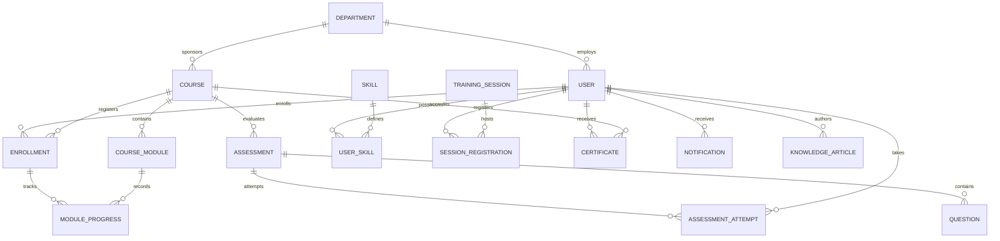

# Capacity Connect — Architecture & System Design Document
**SIH Problem Statement ID: SIH26075**

## 1. Domain Problem Context
Government departments and enterprise organizations face fragmented knowledge systems and misalignment between employee competencies and national administrative priorities. 

Capacity Connect addresses SIH26075 by offering:
- **Centralized competency taxonomy** mapped to Mission Karmayogi standards.
- **Dual assessment workflow** separating self-evaluations from supervisor-verified ratings.
- **Synchronous workshop registration** with capacity caps to manage limited seat cohorts.
- **Deterministic AI-ready learning assistant** providing instant answers from vetted compliance guidelines.
- **Verifiable credential engine** creating tamper-evident digital certificates with cryptographic SHA-256 digests.

## 2. Relational Entity Relationship Diagram (ERD)

## 3. Security Model & RBAC

| Module | Learner | Trainer | Org Manager | Admin |
| :--- | :---: | :---: | :---: | :---: |
| Course Enrollment & Progress | Read/Write (Self) | Read | Read (Team) | Read/Write (All) |
| Quizzes & Certification | Read/Write (Self) | Read | Read (Team) | Full Access |
| Competency Self-Rating | Write (Self) | Write (Self) | Write (Self) | Full Access |
| Competency Supervisor Verification | No | Yes | Yes | Yes |
| Workshop Scheduling | View & Register | Create & Manage | Create & Manage | Full Access |
| SOP Knowledge Authoring | View & Comment | Create & Edit | Create & Edit | Full Access |
| Course Assignment Engine | No | No | Yes | Yes |
| Audit Export (CSV) | No | No | Yes | Yes |

## 4. Verification & Cryptographic Standards
Certificates issued by Capacity Connect feature a SHA-256 verification digest:
$$\text{verificationHash} = \text{SHA256}(\text{CertificateID} \mathbin{\Vert} \text{UserID} \mathbin{\Vert} \text{Timestamp})$$
The public lookup endpoint (`/api/certificates/verify/:certNumber`) verifies against this hash to prevent unauthorized credential tampering.
